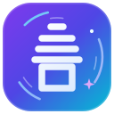
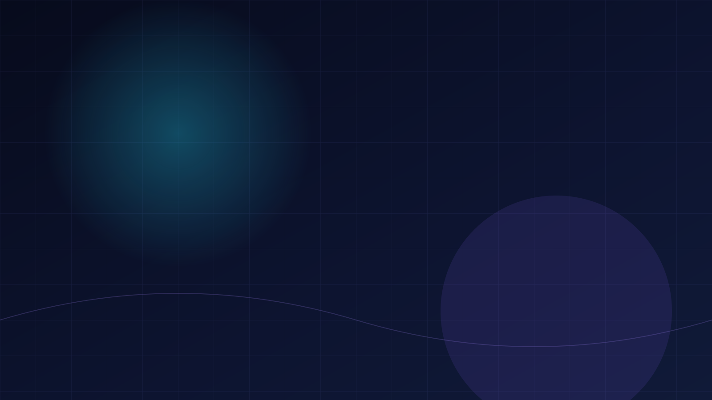
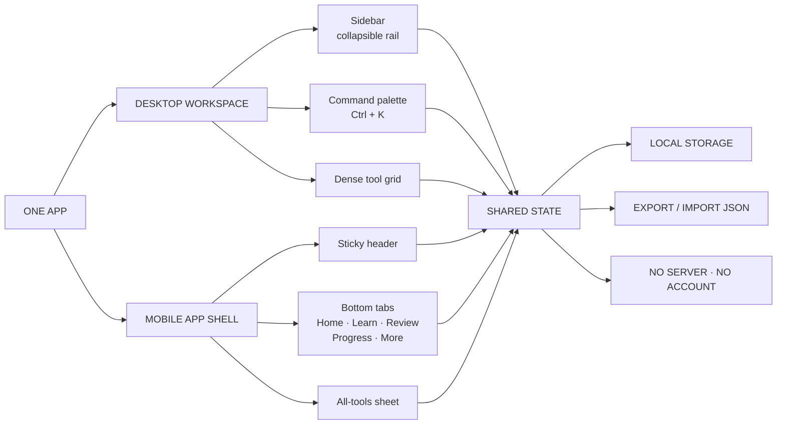
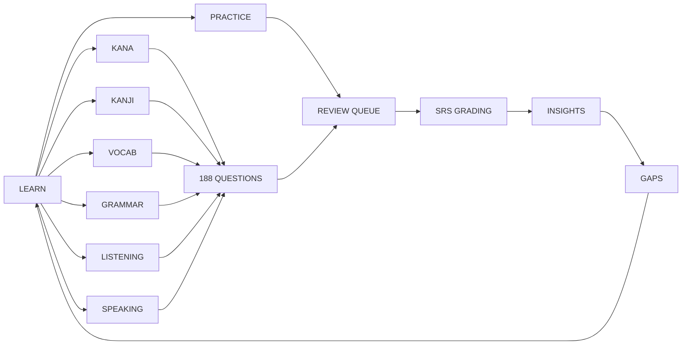
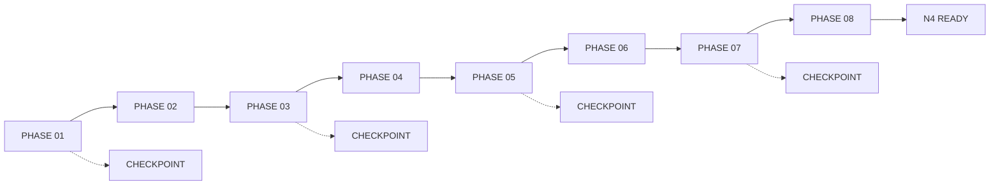
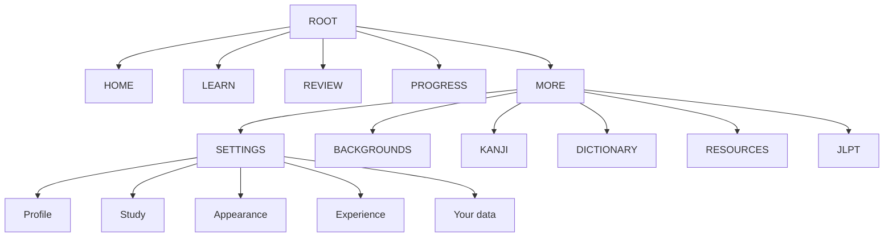
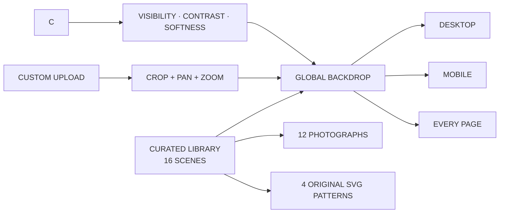
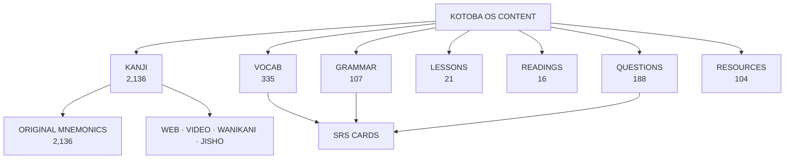
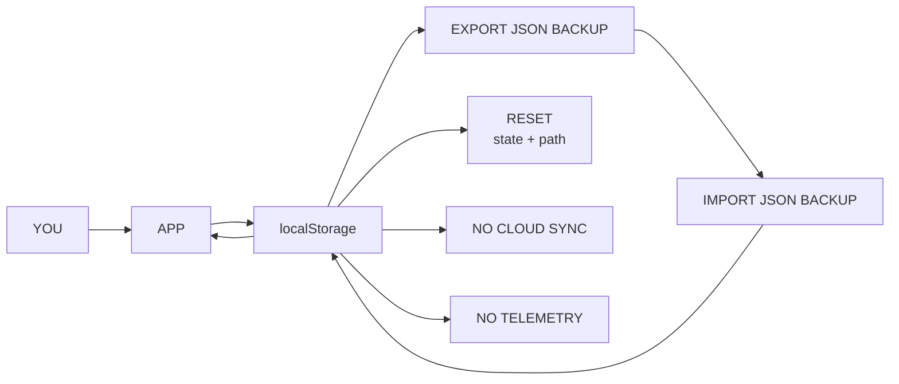

# 言葉 OS · KOTOBA OS

 

 

---

## 🧭 SYSTEM MAP

---

## 🔁 LEARNING LOOP

---

## 🗺️ N4 ROADMAP

---

## 📱 MOBILE APP

---

## 🎨 BACKGROUND STUDIO

---

## 🧠 CONTENT ENGINE

---

## 🔐 DATA FLOW

---

## ⚡ STACK

---

## 🚀 LAUNCH PAD

| LOCAL COMMAND | ACTION |
|---|---|
| `npm install` | install dependencies |
| `npm run dev` | open dev server at `localhost:5173` |
| `npm run build` | produce production `dist/` |
| `npm run preview` | preview production build |

---

 

<b>言葉 OS · 学ぶ、覚える、極める。</b>

